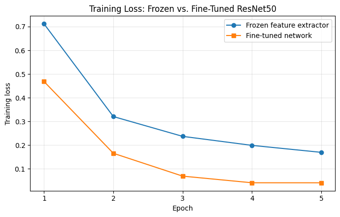

# Home Assignment 3 — Neural Networks and Deep Learning (CS5720)

**Student Name:** Palash Palit
**Course:** CS5720 Neural Network and Deep Learning — Fall 2026
**University:** University of Central Missouri, Department of Computer Science & Cybersecurity

## Overview

This repository contains the code for Part II of Home Assignment 3:

1. **Convolution from scratch:** 2-D convolution written with NumPy loops only (no built-in convolution function).
2. **Transfer learning, freeze vs. fine-tune:** a pretrained ResNet50 reused on a 5-class flower dataset, comparing a frozen feature extractor with a partly fine-tuned network.

The written answers to Part I are in the submitted assignment document.

| File | What it is |
|---|---|
| `q1_convolution_from_scratch.py` | Q1: convolution with NumPy, prints the feature map, its shape, and the stride-2 comparison |
| `q1_output.txt` | Output of the Q1 program |
| `q2_transfer_learning.py` | Q2: both transfer-learning experiments, loss plot and comparison table |
| `HomeAssignment3_Colab.ipynb` | Google Colab notebook with Q1 and Q2 and the actual outputs from my run |
| `training_loss_comparison.png` | Q2 training-loss plot from my run |

## Q1 — Convolution from Scratch

The 5×5 input and 3×3 filter are stored as NumPy arrays. The filter slides over the input, and at each position the program multiplies the 3×3 patch by the filter element by element and sums the result.

- Output feature map (stride 1, padding 0): `[[4, 3, 4], [2, 4, 3], [2, 3, 4]]`, shape **3 × 3**
- With stride 2 the filter skips every other position, so the output shrinks to **2 × 2**: `[[4, 4], [2, 4]]`

Run: `python q1_convolution_from_scratch.py`

## Q2 — Transfer Learning: Freeze vs. Fine-Tune

- **Model:** ResNet50 pretrained on ImageNet, original classifier replaced with Dropout + a 5-class Dense layer
- **Dataset:** TensorFlow flowers (3,670 photos, 5 classes), 80% training / 20% validation
- **Experiment A, feature extraction:** whole base frozen; only the new classifier trains (Adam, lr = 1e-3)
- **Experiment B, fine-tuning:** last convolutional block (`conv5`) unfrozen and trained with the classifier (Adam, lr = 1e-4)
- Both trained for **5 epochs** on a Google Colab T4 GPU

### Results

| Method | Trainable Parameters | Training Time | Validation Accuracy |
|---|---|---|---|
| Frozen Feature Extractor | 10,245 | 94.4 s | 91.69% |
| Fine-Tuned Network | 14,963,717 | 110.1 s | 93.46% |

**Discussion:** Fine-tuning gave higher accuracy and a much lower training loss, because the conv5 features adapted to flowers. It trained about 1,460× more parameters, and backpropagating through the conv5 block made it about 17% slower. It also began to overfit: training accuracy reached 98.9% and validation loss spiked at epoch 4. The frozen extractor was faster and generalized more steadily. That makes it the safer choice for small datasets; fine-tuning is better when accuracy matters and the extra computation is affordable.

Run: open `HomeAssignment3_Colab.ipynb` in Google Colab, select **Runtime → Change runtime type → T4 GPU**, then **Run all** (about 5–10 minutes). The script version needs `pip install tensorflow pandas matplotlib`.
